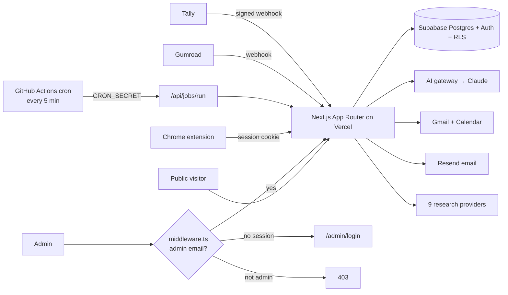

<div align="center">

# Shivam Portfolio · Career CRM

A production Next.js portfolio and blog with a private, authenticated admin that
runs a full **Career CRM** — job pipeline, Gmail/Calendar sync, an AI layer,
workflow automation, multi-source research — plus the backend for the
**Validate Before You Build** paid product.

[](https://nextjs.org/)
[](https://react.dev/)
[](https://www.typescriptlang.org/)
[](https://tailwindcss.com/)
[](https://supabase.com/)
[](https://vercel.com/)
[](.github/workflows/ci.yml)

**Production:** [www.shivamchaturvedi.com](https://www.shivamchaturvedi.com)

</div>

---

## Overview

One codebase, two products:

1. **Public site** — portfolio, blog, project pages, a public Resume AI demo,
   the Validate Before You Build (VBYB) product page, and a spam-protected
   contact funnel.
2. **Admin / Career CRM** — a private back office at `/admin` for running a job
   search end to end, with AI assistance, automation and integrations.

| | |
|---|---|
| Admin modules | 19 |
| Database tables | 45 (14 additive migrations, RLS on every table) |
| Feature flags | 23 (server-side, default off) |
| Unit tests | ~1,500 (Vitest) |

---

## Architecture



- **Middleware** refreshes the Supabase session (time-bounded) and lets only the
  allowlisted admin email into `/admin/*`; other sessions get 403.
- **Supabase clients:** browser, server (SSR) and service-role (server-only).
- Details: [`docs/architecture/SYSTEM_ARCHITECTURE.md`](docs/architecture/SYSTEM_ARCHITECTURE.md),
  [`docs/architecture/PHASE_3_ARCHITECTURE.md`](docs/architecture/PHASE_3_ARCHITECTURE.md).

---

## Technology stack

| Layer | Technology |
|-------|------------|
| Framework | Next.js 15 (App Router), React 19 |
| Language | TypeScript 5 |
| Styling | Tailwind CSS 3.4, `clsx`, `tailwind-merge`, Framer Motion, lucide-react, next-themes |
| Data / Auth | Supabase (`@supabase/ssr`, `@supabase/supabase-js`), Postgres + RLS |
| AI | Anthropic SDK behind a provider-neutral gateway |
| Email | Resend |
| Bot protection | Cloudflare Turnstile |
| File parsing | `pdfjs-dist` (PDF), DOCX/ZIP parsers, `sanitize-html` |
| Monitoring | Sentry, Vercel Analytics |
| Testing | Vitest, Testing Library, Playwright + axe |
| Hosting / CI | Vercel, GitHub Actions |

---

## Features

### Public site

| Route | What it does |
|-------|--------------|
| `/` | Hero, About, Skills, Projects, Case Studies, AI Research, Who I Help, Ebook, CTA, Contact |
| `/blog`, `/blog/[slug]` | Blog |
| `/projects/[slug]` | Project detail pages |
| `/demo` | Public Resume AI demo — upload a resume + JD, get a match analysis (Turnstile, per-visitor throttle, daily token budget) |
| `/validate-before-you-build` | VBYB product page ($39, Gumroad checkout) |
| `/whoasked` | "Who Asked?" media brand page |
| Contact form | Turnstile + rate limit → Supabase inquiry → Resend notification |

### Admin / Career CRM

| Module | Flag | What it does |
|--------|------|--------------|
| Dashboard | — | Overview metrics |
| Inquiries | — | Contact leads: search, filters, status, lead source, notes, timeline, CSV export |
| Opportunities | — | Pipeline board, job descriptions, events, notes, linked contacts |
| Companies / Contacts | — | CRUD + detail pages |
| Messages | — | Gmail-synced email |
| Tasks | — | Priority, status, due dates |
| Calendar | — | Google Calendar sync, upcoming interviews |
| Assistant | `FEATURE_ASSISTANT` | AI chat with retrieval tools over CRM data |
| Approvals | `FEATURE_EMAIL_DRAFTING` | AI-drafted replies; nothing sends without approval |
| Automations | `FEATURE_AUTOMATION` | Rules: triggers → conditions → actions |
| Resume AI | — | Resume/JD analysis, cover letters, interview questions, LinkedIn optimizer, rewrites, DOCX export |
| Documents | — | Resume and cover letter versions |
| Browser Inbox | — | Jobs captured by the Chrome extension |
| Job Feed | `FEATURE_AIDEVBOARD` | AIDevBoard listings |
| Research | `FEATURE_RESEARCH` | Cross-provider job/company/news/macro/scholarly search |
| VBYB | `FEATURE_VBYB` | Orders, customers, validations, analytics |
| Analytics / Settings | — | CRM analytics; integrations and notification preferences |

The sidebar renders from [`lib/admin/navigation.ts`](lib/admin/navigation.ts).
Flags live in [`lib/featureFlags.ts`](lib/featureFlags.ts): a feature is on
only when its env var is exactly `"true"`, so rollback is an env change, not a
redeploy.

### Backend subsystems

| Subsystem | Where | Notes |
|-----------|-------|-------|
| Background jobs | `lib/jobs/` | Postgres queue; drained by `/api/jobs/run` every 5 min from [GitHub Actions](.github/workflows/drain-jobs.yml). Handlers: gmail-sync, calendar-sync, ai-summarize, notification-scan/dispatch, automation-scan/run |
| Google integration | `lib/integrations/google/`, `lib/sync/` | OAuth with state table; tokens AES-256-GCM encrypted; incremental Gmail sync (historyId cursor); Calendar sync |
| AI gateway | `lib/ai/` | Single path to the provider: prompt templates, secret redaction, atomic token budget, tool authorization, output validation, audit log |
| Approved send | `lib/ai/send.ts` | Claim-then-send ordering so an approved email can never send twice |
| Automation | `lib/automation/` | Triggers on opportunity/message/task events or schedule; actions: create task, add note, change stage, draft email, notify. Rules start disabled |
| Notifications | `lib/notifications/` | New messages, overdue tasks, upcoming interviews → email, idempotent |
| Research | `lib/research/` | Adzuna, USAJobs, AI-Dev-Jobs, AI-Jobs.co, SEC EDGAR, GNews, Noozra, FRED, OpenAlex; fan-out, merge, dedupe; one failing provider never fails the search |
| Career intelligence | `lib/career-intelligence/`, `lib/resume*/`, `lib/ai-analysis/` | PDF/DOCX/ZIP parsing, AI job match (cached), versions, diff, DOCX export |
| Capture | `extension/`, `lib/capture/`, `/api/capture` | MV3 extension: JSON-LD + heuristics → review → save; uses the admin session, no CORS |
| VBYB | `lib/vbyb/`, `/api/webhooks/*` | Gumroad pings re-verified via API; Tally HMAC-SHA256; order↔submission matching; PAID → SUBMITTED → IN PROGRESS → DELIVERED workflow with refunds |

### API routes

| Route | Purpose |
|-------|---------|
| `POST /api/contact` | Public contact form |
| `/api/admin/inquiries/*` | Inquiry status, notes, lead source, delete, CSV export |
| `/api/auth/*`, `/auth/callback` | Signup, role, auth callback |
| `/api/ai/chat` | Assistant |
| `/api/capture`, `/api/capture/save` | Extension capture (structure, then save) |
| `/api/integrations/google/*` | Google OAuth connect + callback |
| `/api/jobs/run`, `/api/jobs/health` | Job drainer (secret-protected) + health |
| `/api/webhooks/gumroad`, `/api/webhooks/tally` | VBYB payments + form submissions |

Full reference: [`docs/architecture/API_REFERENCE.md`](docs/architecture/API_REFERENCE.md).

---

## Folder structure

```
.
├── app/
│   ├── (marketing)/      # Public site, blog, demo, VBYB, whoasked
│   ├── admin/            # (dashboard)/ modules + login, signup, reset-password
│   ├── api/              # Route handlers (see table above)
│   └── auth/             # Auth callback / verified
├── components/           # admin · auth · demo · layout · sections · ui
├── extension/            # CareerCRM Capture Chrome extension (MV3)
├── lib/                  # Domain logic: ai, automation, jobs, integrations,
│                         # sync, research, resume, capture, vbyb, supabase, …
├── supabase/             # schema.sql + migrations/
├── test/                 # Vitest unit tests
├── e2e/                  # Playwright specs
├── docs/                 # Architecture, ADRs, database, security, runbooks
├── middleware.ts         # Admin gate for /admin/:path*
└── types/  constants/  public/  scripts/
```

---

## Development

**Prerequisites:** Node.js 24 (matches CI and Vercel), a Supabase project.

```bash
npm install
cp .env.example .env.local   # fill in values; see .env.example for every key
npm run dev                  # http://localhost:3000

# Quality gates (same as CI)
npm run lint
npm run typecheck
npm test
npm run build

# E2E (local only — not run in CI)
npm run test:e2e
```

Feature flags (`FEATURE_*`) default off. Turn on only what you are working on.

---

## Deployment

- **App:** Vercel, connected to `main`. Every push to `main` deploys production.
- **CI:** [`ci.yml`](.github/workflows/ci.yml) runs lint, typecheck, test and
  build on every PR and on `main`, with no secrets.
- **Jobs:** [`drain-jobs.yml`](.github/workflows/drain-jobs.yml) calls
  `/api/jobs/run` every 5 minutes (best effort; handlers are idempotent).
- **Database:** Vercel does not run migrations. Apply `supabase/migrations/`
  separately (Supabase CLI or SQL editor); migrations are additive.
- Runbook: [`docs/operations/RUNBOOK.md`](docs/operations/RUNBOOK.md).

---

## Database

Postgres on Supabase, RLS on every table. 45 tables in these groups:

| Group | Tables |
|-------|--------|
| Inquiries | `inquiries`, `inquiry_notes`, `inquiry_activity`, `inquiry_attachments` |
| CRM | `companies`, `contacts`, `opportunities`, `opportunity_*`, `messages`, `message_attachments`, `tasks`, `tags`, `taggables` |
| Integrations + jobs | `integration_accounts`, `oauth_states`, `jobs`, `calendar_events` |
| Notifications | `notifications`, `notification_preferences` |
| AI | `ai_conversations`, `ai_messages`, `ai_audit_log`, `ai_approvals`, `ai_decisions`, `ai_usage_counters`, `prompt_templates`, `inbox_items` |
| Automation | `automation_rules`, `automation_runs` |
| Career intelligence | `documents`, `resume_versions`, `cover_letter_versions` |
| Demo | `demo_usage` |
| VBYB | `vbyb_*` (9 tables) |

Conventions: `uuid` PKs, `timestamptz` audit columns, shared `updated_at`
trigger, `owner_id` on every row, full-text search via generated `tsvector`.
Detail: [`docs/database/DATABASE_GUIDE.md`](docs/database/DATABASE_GUIDE.md),
[`docs/database/SCHEMA_REFERENCE.md`](docs/database/SCHEMA_REFERENCE.md).

---

## Roadmap

| Phase | Name | Status |
|-------|------|--------|
| 0 | Portfolio Website | ✅ Complete |
| 1 | Career CRM Foundation | ✅ Complete |
| 2 | CRM Application | ✅ Complete (`v1.0.0`) |
| 3 | Integrations, AI & Automation | 🟡 Built behind flags; M8b (vector retrieval) pending |
| — | Resume AI, public demo, Research, VBYB | ✅ Shipped |
| 4 | Reporting | ⬜ Not started |
| 5 | Production Hardening | 🟡 Partial (CI, Sentry, security audits) |

Full detail: [`docs/roadmap/PROJECT_ROADMAP.md`](docs/roadmap/PROJECT_ROADMAP.md).

---

## Documentation

| Document | Purpose |
|----------|---------|
| [`docs/architecture/SYSTEM_ARCHITECTURE.md`](docs/architecture/SYSTEM_ARCHITECTURE.md) | System architecture |
| [`docs/architecture/decisions/`](docs/architecture/decisions/README.md) | ADR-001 … ADR-012 |
| [`docs/ai/AI_ARCHITECTURE.md`](docs/ai/AI_ARCHITECTURE.md) | AI layer design |
| [`docs/database/DATABASE_GUIDE.md`](docs/database/DATABASE_GUIDE.md) | Database guide + ER diagram |
| [`docs/integrations/research-providers.md`](docs/integrations/research-providers.md) | Research providers |
| [`docs/integrations/validate-before-you-build.md`](docs/integrations/validate-before-you-build.md) | VBYB integration |
| [`docs/SECURITY.md`](docs/SECURITY.md) | Security model |
| [`docs/TESTING_GUIDE.md`](docs/TESTING_GUIDE.md) | Testing guide |
| [`docs/design/DESIGN_SYSTEM.md`](docs/design/DESIGN_SYSTEM.md) | Design system |
| [`extension/README.md`](extension/README.md) | Chrome extension setup |

---

<div align="center">
<sub>Built with Next.js, Supabase, and Vercel.</sub>
</div>
